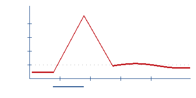

# BIO-20261013-001

> **虚构夹具。** 题干为编造内容，仅演示「图表读不出」这一错因的记录格式。

## 题干摘要（虚构）

甲图是一条虚构曲线，横轴为时间、纵轴为膜内外电位差。
题目问：0~2 ms 区间内曲线出现一次快速上升后回落，
问该上升段的离子进出方向，以及回落段对应的离子。

## 我的错解

看到曲线上升就直接选了「K⁺ 外流」，因为记得
「静息电位是 K⁺ 外流造成的」。

**根本没去看纵轴的正负和上升段的时间点。**把「电位差变大」
和「膜内侧变正」搞混了方向。

## 正解思路

1. 先确认纵轴是什么、零点在哪——图都没看就作答，这是错的根源
2. 上升段对应膜内电位由负变正，是 Na⁺ 内流
3. 回落段对应 Na⁺ 通道失活、K⁺ 外流，恢复外正内负

## 一句话教训

**看图先看轴。** 任何图表题，动笔前先把横轴纵轴分别是什么、
零点在哪写下来。跳过这一步，后面全靠猜。

## 这题的价值

**高**。「看图先看轴」属于**方法层**的漏洞，不是这根曲线没背熟。
方法层的漏洞换任何一张图都会复现，所以判 `高` 而不是 `中`——
它值得单独占一条复习队列。

## 知识点指向

`point_ref: KP-20261013-01` —— 见 `../points/KP-20261013-01.md`

## 复习记录

| 日期 | 结果 | 备注 |
|---|---|---|
| 2026-10-13 | 首次订正 | 错因：图表读不出 |